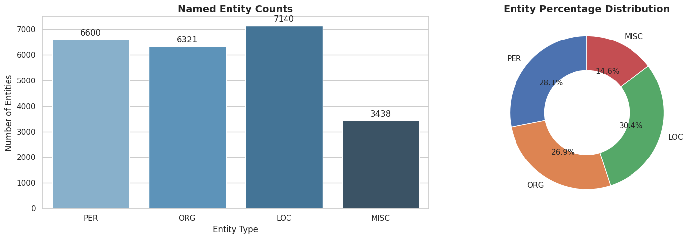
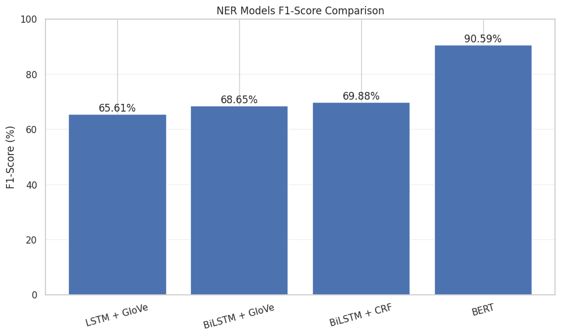

# Named Entity Recognition System

Finds people (PER), organizations (ORG), locations (LOC) and miscellaneous entities (MISC) in English text. It compares LSTM, BiLSTM, BiLSTM-CRF and fine-tuned BERT on CoNLL-2003, and serves BERT in a Gradio app that highlights entities.

## Dataset

[CoNLL-2003, English](https://www.kaggle.com/datasets/alaakhaled/conll003-englishversion): 14,041 training, 3,250 validation and 3,453 test sentences with BIO tags, and 23,499 entities in the training set.



## Results

Entity-level scores on the test set, computed with `seqeval`:

| Model | Precision | Recall | F1 |
|---|---|---|---|
| LSTM + GloVe | 74.7% | 58.5% | 65.6% |
| BiLSTM + GloVe | 78.1% | 61.3% | 68.7% |
| BiLSTM + CRF | 79.8% | 62.2% | 69.9% |
| **BERT (`bert-base-cased`)** | **89.8%** | **91.4%** | **90.6%** |

> The recurrent models truncate sentences to 37 tokens, so they are scored on 5,507 entities. BERT is scored on 5,644.



BERT per entity:

| Entity | Precision | Recall | F1 |
|---|---|---|---|
| PER | 0.96 | 0.96 | 0.96 |
| LOC | 0.94 | 0.93 | 0.93 |
| ORG | 0.86 | 0.91 | 0.88 |
| MISC | 0.76 | 0.81 | 0.78 |

## Approach

- **Recurrent models:** 100d GloVe embeddings (88.9% vocabulary coverage), 128 hidden units; the best epoch by validation loss is kept
- **CRF:** scores whole tag sequences, so each tag depends on its neighbours
- **BERT:** subwords aligned to word labels (first subword only), 3 epochs, learning rate 2e-5
- **App:** long text is split into overlapping 128-token windows, and subwords are merged back into whole entities

## Limitations

- Unseen words likely hold back the recurrent models' recall: the vocabulary comes from the training set only, and `<UNK>` never occurs during training.
- MISC is the hardest class for BERT.

## Demo

[demo/demo.mp4](demo/demo.mp4)

## Run it

1. Open [the notebook](notebooks/entity-recognition-system.ipynb) on Kaggle with a GPU and internet enabled.
2. Attach the dataset above and check that `DATA_PATH` matches.
3. The saved notebook was not run strictly top to bottom. For a fresh run:
   - install `seqeval` and `pytorch-crf` before the imports cell
   - add `import requests` and `from IPython.display import Markdown, display`
   - use `HFDataset.from_list(...)` in place of `Dataset.from_list(...)` in the BERT section

To work locally, run `pip install -r requirements.txt` and change the `/kaggle/...` paths. Trained weights are not included.

## Structure

```
├── notebooks/entity-recognition-system.ipynb
├── assets/
├── demo/demo.mp4
├── requirements.txt
└── README.md
```
